# UrbanFlow AI · Model Experimentation

[](LICENSE)


**A reproducible research pipeline for regional urban-demand forecasting:
66.9 million retained historical trips, causal multi-step inference, and a frozen
June 2016 evaluation.**

This repository preserves the research behind UrbanFlow AI's 30-region, 15-minute NYC taxi demand forecasting model: original notebooks, causal feature code, bounded model comparisons, protocols, frozen artifacts and evaluation evidence. The [deployment platform](https://github.com/Sohamgaonkhadkar/UrbanFlow-AI-Spatiotemporal-Demand-Forecasting-Platform/tree/codex/final-v4-integration-20261102) serves the selected model through FastAPI and the finalized cinematic frontend.

The selected **v4 calendar-feedback** model combines gradient boosting,
training-only calendar structure and causal recursive feedback. This repository
provides the evidence needed to inspect the result: ordered feature schemas,
selection protocols, acquisition provenance, frozen artifacts, sealed prediction
arrays and executable validation tests.

## Project at a glance

| Dimension | Verified scope |
|---|---|
| Research question | Forecast retained completed Yellow Taxi trips across regional time series |
| Observation panel | 66,874,467 retained trips; 524,040 region/time rows; January–June 2016 |
| Spatial / temporal resolution | 30 fixed K-means regions / 15-minute bins |
| Forecast trajectory | Up to 48 steps, covering 12 hours |
| Selected model | XGBoost with recursive calendar feedback; 46 fitted features |
| Primary result | 9.7507% WAPE at one step; 11.6086% cumulative WAPE over 48 steps |
| Primary evaluation | 55 non-overlapping June origins; 79,200 region/lead predictions |
| Validation | 118 research tests passed in the recorded integration run |

The project demonstrates chronological evaluation, training/inference feature
agreement, original-scale count forecasting, regional consistency, and a clear
boundary between experimental evidence and application serving. The benchmark
is historical; it does not establish current operational performance.

## Contents

- [Final result](#final-result)
- [Selected architecture](#selected-architecture)
- [Research sequence and evidence](#research-sequence-and-evidence)
- [Dataset and target definition](#dataset-and-target-definition)
- [Layout](#layout)
- [Reproduce validation](#reproduce-validation)
- [Research directions](#research-directions)
- [Operational relationship](#operational-relationship)
- [License and third-party materials](#license-and-third-party-materials)


## Final result

| Horizon, cumulative | WAPE |
|---|---:|
| 15 minutes / 1 step | 9.7507% |
| 1 hour / 4 steps | 10.1260% |
| 3 hours / 12 steps | 11.1766% |
| 6 hours / 24 steps | 11.4557% |
| 12 hours / 48 steps | 11.6086% |

At 12 hours: **MAE 14.5595**, **RMSE 23.9458**, **R² 0.960489**, **bias +2.5667%**. The June 2016 primary evaluation comprises **55** non-overlapping origins spaced 13 elapsed hours apart, **30** regions and **48** leads: **79,200 predictions**. The individual lead-48 WAPE is **13.5862%**. Cumulative 12-hour WAPE has a 3-origin moving-block bootstrap 95% interval of **10.7556–12.5330%** (1,000 draws, seed 42). That interval quantifies metric uncertainty, not prediction uncertainty for individual counts.

WAPE is `100 × Σ|prediction − actual| / Σ|actual|`. Lower is better; these values are error rates, not a classification-accuracy percentage. No model achieved a sub-10% cumulative 12-hour WAPE. Results for April, May and June use different cutoffs and periods; differences between those months are not paired model improvements.

## Selected architecture

The canonical artifact is `artifacts/v4_20261102/candidate_v4.joblib`, candidate ID `v4_calendar_feedback`. The selected specification combines:

1. A global XGBoost absolute-error component, 599 fitted boosted trees and 46 ordered fitted features.
2. A training-only weekday/quarter-hour calendar profile with origin-local gain adaptation.
3. Causal 15-minute recursion across all 30 regions, feeding the final blended result into subsequent lags.
4. A gradual seasonal anchor and calendar weight growing with lead, retaining the exact frozen implementation.

The fitted schema is `feature_schema.json`; the artifact's legacy top-level feature union is not the fitted 46-column schema. Runtime compatibility classes live under `urbanflow/ml`. The deployment repository extracts only the selected inference classes and preserves their module names and forecast arithmetic, avoiding training-library imports in the serving application. Archived June prediction parity verifies that extraction.

Training labels end at **May 31, 2016 21:45 America/New_York**. The exclusive training cutoff is **22:00**, retaining the protocol's 2-hour gap. Warmup needs 1,536 bins (16 days). Training labels therefore begin January 17. Feature calculations and origin adaptation use observations strictly before each origin. Later June observations can legitimately become history for later June origins; they never alter fitted weights or selection.

```mermaid
flowchart LR
  Source[Historical coordinate-bearing taxi records] --> Panel[Fixed regions and 15-minute counts]
  Panel --> Features[Causal features and calendar context]
  Features --> Development[Chronological development comparisons]
  Development --> Freeze[Frozen selection and May cutoff]
  Freeze --> June[Sealed June evaluation]
  June --> Artifact[Versioned artifact and evidence]
  Artifact --> Serving[Separate deployment platform]
```




This diagram describes the completed research sequence. June outcomes are now
spent evaluation evidence and are not an untouched selection window for future
experiments.

## Research sequence and evidence

The experiments retain chronological development, causal feature construction and explicit final-test sealing. March, April and May were spent development windows. June was the primary final month after freezing selection; it is now spent evaluation evidence and must not be described as an untouched test for future experiments.

The v4 study examined 17 bounded recipes across three development windows, including extra historical holiday profiles, temporal aggregation/disaggregation and reconciliation, expanding/rolling/decayed history, sparse-count objectives and calendar alternatives. Novel recipes did not clear the prespecified material improvement threshold of 0.1 WAPE point with the required paired confidence and regional/monthly checks. The strongest existing calendar-feedback specification was retained and fit at the frozen May cutoff.

The frozen June comparison reports:

| Model | Cumulative 12-hour WAPE |
|---|---:|
| Selected calendar-feedback model | **11.6086%** |
| Pure XGBoost | 11.7512% |
| Pure LightGBM | 11.8268% |

Paired differences from the selected model have confidence intervals crossing
zero; the small ranking differences are not conclusive statistical superiority.
Sparse regions, airports, weekends and nights remain more difficult.
Actual-peak-conditioned diagnostics are retrospective subgroup summaries,
not features available at an origin.

The prespecified July 1–7 holiday confirmation was **not executed**: compatible complete coordinate-bearing source coverage could not be established. The official July schema inspected in the study used taxi-zone IDs, which cannot exactly reproduce the original point mapping and pickup/dropoff filters. No replacement period was substituted. See the availability ledger and frozen report for the bounded probes and their limitations.

Start with these records:

- [Complete v4 report](reports/research_driven_forecasting_v4.md)
- [artifacts/v4_20261102/protocol.json](artifacts/v4_20261102/protocol.json) — test and selection protocol, original protected hashes.
- [artifacts/v4_20261102/selection_freeze.json](artifacts/v4_20261102/selection_freeze.json) — exact frozen selection and secondary-test availability.
- [artifacts/v4_20261102/training_metadata.json](artifacts/v4_20261102/training_metadata.json) — cutoffs and fitted component metadata.
- [artifacts/v4_20261102/final_test_results.json](artifacts/v4_20261102/final_test_results.json) — complete primary/secondary evaluation ledger.
- [artifacts/v4_20261102/june_primary_predictions.npz](artifacts/v4_20261102/june_primary_predictions.npz) — sealed truth and forecast arrays.
- [artifacts/v4_20261102/frozen_source/](artifacts/v4_20261102/frozen_source/) — original frozen study source snapshots.
- [reports/v4_20261102/](reports/v4_20261102/) — acquisition, environment, sensitivity and system evidence.

## Dataset and target definition

The target is **retained completed Yellow Taxi trips per fitted region per 15-minute bin**, not all requests, all NYC pickups or latent unmet demand. Original coordinate-bearing records use fixed pickup/dropoff geographic bounds (latitude 40.60–40.85, longitude −74.05–−73.70), fare $0.50–81.00 and trip-distance 0.25–24.43 mile filters. Both pickup and dropoff must satisfy the geographic bounds. June was acquired from NYC Open Data dataset `uacg-pexx` using bounded, reusable day intervals; compatible historical sources and exact probes are recorded in the acquisition provenance.

The original fitted scaler and 30 K-means centers remain fixed. `artifacts/advanced_20261102/geography.json` preserves their mean, scale and centers. Longitude is the first coordinate. Inverse-transforming gives the verified centroid for each model region ID. Neighborhood labels from earlier interfaces were not authoritative cluster identities; the serving application uses generic sector names and does not invent cluster polygons.

The genuine dense panel spans January 1 through June 30, 2016, with zero bins retained under source-completeness assumptions and historical DST handling documented in the report. The canonical deployment observation panel is included. Research raw trip files, daily downloads and feature caches are deliberately omitted from Git. Intermediate exclusions and original hashes are recorded in `provenance/excluded_generated_artifacts.json` and `provenance/original_workspace.json`.

Fare/distance/completion filters require post-trip information. Immediate availability of a completed-bin count is an idealized benchmark assumption. No independent production as-of feed certification, current-domain generalization, weather contribution, calibrated prediction intervals, validated whole-hybrid attribution or operational alerts is established by this work. July holiday robustness remains unvalidated.

## Layout

```text
notebooks/                       Original research notebooks, including local improvements
urbanflow/ml/advanced/           Causal features, comparisons and calendar-feedback model
urbanflow/ml/nextgen/            Profile/adaptation/calibration research
urbanflow/ml/v4/                 Acquisition, alternatives, frozen protocol and tests
urbanflow/backend/               Preserved historical research/API compatibility source
urbanflow/tests/                 Preserved core research and backend tests
artifacts/                       Canonical candidates, panels, schemas and numeric evidence
reports/                         Detailed research reports and diagnostics
provenance/                      Original hashes/status and generated-output exclusion ledger
requirements-local-lock.txt      Exact tested research environment
pytest.ini                      Portable package/test discovery
LICENSE                         MIT license for original software/documentation
THIRD_PARTY_NOTICES.md           Dataset, dependency and embedded-material notices
```

The `urbanflow/ml` package depth is intentional: root-relative research paths resolve within this repository. Experimental source, serving compatibility code and versioned evidence remain separate from generated caches and raw downloads. Earlier notebook versions remain available in Git history.

## Reproduce validation

Use Python **3.14**. The completed v4 work is currently on
`codex/final-v4-integration-20261102`; clone that branch while the default branch retains
the earlier version:

```powershell
git clone --branch codex/final-v4-integration-20261102 https://github.com/Sohamgaonkhadkar/UBER-DEMAND-PREDICTION.git Model-Experimentation
cd Model-Experimentation
```

Create the research environment and execute validation from the repository root:


```powershell
py -3.14 -m venv .venv
.venv\Scripts\python.exe -m pip install -r requirements-local-lock.txt
.venv\Scripts\python.exe -m pytest -q
```

The suite covers causal lags, batch/training feature agreement, recursive joint feedback, future poisoning, original-scale transforms, calendar behavior, DST handling, API validation, coarse temporal coherence, acquisition retries and cached feature identity. The executed integration validation passed **106 core tests plus 12 v4 tests**. Detailed commands, environment and warnings are in `FINAL_INTEGRATION_REPORT.md`.

For application inference and the minimal dependency set, use the separate deployment repository; it requires neither the full experiment stack nor raw data. Its acceptance tests independently recompute June metrics and compare the portable frozen artifact with sealed predictions.

To review or reproduce a research procedure, inspect `urbanflow/ml/v4/protocol.py` and the corresponding module before execution. Run modules with the original package root:

```powershell
$env:PYTHONPATH = Join-Path (Get-Location) 'urbanflow'
# Read the frozen protocol and source first. Acquisition can be expensive.
.venv\Scripts\python.exe -m ml.v4.availability
```

Acquisition/research entry points may contact public data services, create caches, consume substantial resources, refit models or require excluded raw input. They are preserved for reproducibility and are **not** automatically run by the validation command. Network availability and exact historical upstream content cannot be guaranteed. Do not rerun model selection against spent June outcomes. A future study needs a new frozen protocol and genuinely unexamined compatible evaluation data.

## Research directions

The following are future research objectives, not capabilities already validated
by the v4 benchmark:

1. Establish compatible, complete coordinate-bearing evaluation data beyond
   June, including an independently frozen holiday/event window.
2. Audit the availability time of completed-trip aggregates before testing an
   operational as-of forecast feed.
3. Evaluate calibrated count-prediction intervals on new chronological cohorts,
   with explicit regional and horizon coverage checks.
4. Assess domain shift and difficult sparse/night/weekend segments without
   changing selection rules in response to spent final-test outcomes.

Contributions should include a frozen evaluation protocol, causal feature
checks, reproducible environment information and evidence beyond a single
aggregate score. New candidates should be published under a new artifact ID;
the selected v4 artifact and its sealed evaluation evidence remain immutable.

## Operational relationship

This research checkout owns experiments and evidence. The deployment checkout owns a compact checked-in runtime bundle, genuine observation seed, stable API contract, cinematic frontend, Compose definition and integration tests. Neither depends on the other's local filesystem path. No secrets, environment directories, raw trip exports or generated model-search checkpoints should be committed. Hashes identify the selected artifact in both repositories; no model was retrained during final integration.

## License and third-party materials

Original UrbanFlow AI software and documentation are available under the
[MIT License](LICENSE), copyright © 2026 Soham Mahesh Gaonkhadkar.
Third-party photographs, source datasets, map services, fonts and dependencies
retain their applicable terms; see [third-party notices](THIRD_PARTY_NOTICES.md).

## Author

**Soham Mahesh Gaonkhadkar** · [GitHub](https://github.com/Sohamgaonkhadkar)
