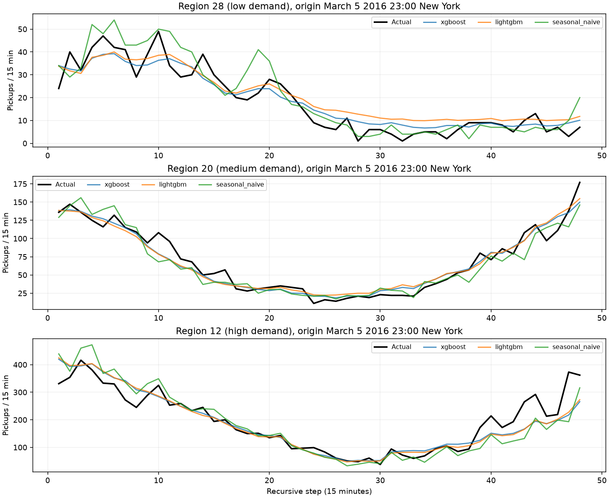
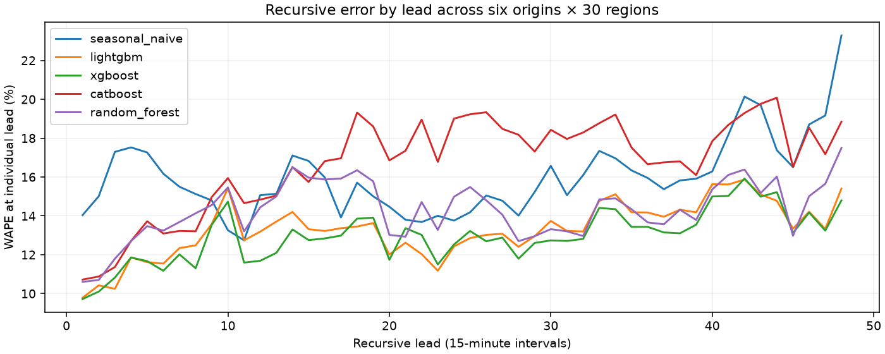

# Recursive forecasting backtest

At each origin only preceding observations are passed to the forecaster. Each predicted value is fed back before subsequent features are computed. Models receive no held-out demand during a trajectory. Origins: March 1 00:00; March 5 23:00; March 10 06:00; March 18 17:00; March 26 23:00; March 30 12:00, all America/New_York in 2016. Validation origins: February 16 00:00, February 20 12:00, February 27 23:00.

Metrics below are **cumulative through horizon H**, not error only at step H. 1, 4, 12, 24 and 48 intervals mean 15 minutes, 1 hour, 3 hours, 6 hours and 12 hours. `step_metrics.csv` provides individual-lead metrics. WAPE = 100 × Σ|y−ŷ| / Σ|y|; undefined when all targets are zero. R² is omitted for constant targets.

| Model | H | MAE | RMSE | WAPE % | R² |
| --- | --- | --- | --- | --- | --- |
| seasonal_naive | 1 | 19.5944 | 30.4575 | 14.0412 | 0.9483 |
| seasonal_naive | 4 | 22.8292 | 37.2105 | 16.0016 | 0.9239 |
| seasonal_naive | 12 | 22.6093 | 36.1839 | 15.3142 | 0.9412 |
| seasonal_naive | 24 | 20.2745 | 33.7269 | 15.1800 | 0.9444 |
| seasonal_naive | 48 | 20.8034 | 34.5163 | 16.0035 | 0.9366 |
| lightgbm | 1 | 13.6588 | 21.3625 | 9.7878 | 0.9746 |
| lightgbm | 4 | 15.1191 | 23.3364 | 10.5974 | 0.9701 |
| lightgbm | 12 | 17.9212 | 30.2258 | 12.1388 | 0.9589 |
| lightgbm | 24 | 16.7140 | 29.6634 | 12.5141 | 0.9570 |
| lightgbm | 48 | 17.2807 | 28.5337 | 13.2936 | 0.9567 |
| xgboost | 1 | 13.5641 | 21.1444 | 9.7199 | 0.9751 |
| xgboost | 4 | 15.1895 | 23.9486 | 10.6467 | 0.9685 |
| xgboost | 12 | 17.2990 | 27.5358 | 11.7173 | 0.9659 |
| xgboost | 24 | 16.3085 | 27.0020 | 12.2105 | 0.9644 |
| xgboost | 48 | 16.8071 | 26.6408 | 12.9293 | 0.9622 |
| catboost | 1 | 14.9613 | 23.1866 | 10.7211 | 0.9700 |
| catboost | 4 | 16.3199 | 25.4879 | 11.4391 | 0.9643 |
| catboost | 12 | 19.6550 | 30.5355 | 13.3132 | 0.9581 |
| catboost | 24 | 20.1304 | 31.5977 | 15.0721 | 0.9512 |
| catboost | 48 | 21.5274 | 31.6401 | 16.5605 | 0.9467 |
| random_forest | 1 | 14.7987 | 22.9047 | 10.6046 | 0.9708 |
| random_forest | 4 | 16.3685 | 26.8758 | 11.4732 | 0.9603 |
| random_forest | 12 | 19.4955 | 35.1709 | 13.2051 | 0.9444 |
| random_forest | 24 | 18.7539 | 36.0193 | 14.0414 | 0.9366 |
| random_forest | 48 | 18.5695 | 33.8366 | 14.2850 | 0.9391 |
| original_api (sensitivity) | 1 | 23.4263 | 33.0451 | 16.7870 | 0.9391 |
| original_api (sensitivity) | 4 | 40.2446 | 56.8155 | 28.2086 | 0.8226 |
| original_api (sensitivity) | 12 | 84.5763 | 118.8222 | 57.2872 | 0.3654 |
| original_api (sensitivity) | 24 | 138.9386 | 179.8980 | 104.0263 | -0.5810 |
| original_api (sensitivity) | 48 | 211.1076 | 250.5393 | 162.3996 | -2.3399 |

For XGBoost the cumulative WAPE rises from 9.7199% at one step to 12.9293% through 48 steps. Individual errors need not rise monotonically because later targets and demand levels differ. One-step March evaluation uses a different population from these selected rolling origins.

## Regional and peak robustness

| Model | Demand tier | MAE | RMSE | WAPE % | R² |
| --- | --- | --- | --- | --- | --- |
| catboost | high | 29.3886 | 40.9743 | 12.5912 | 0.9371 |
| catboost | low | 12.1953 | 19.5445 | 45.5639 | 0.5758 |
| catboost | medium | 22.9984 | 30.6988 | 17.7174 | 0.8732 |
| lightgbm | high | 26.0036 | 40.1317 | 11.1409 | 0.9397 |
| lightgbm | low | 7.4664 | 11.7459 | 27.8960 | 0.8468 |
| lightgbm | medium | 18.3719 | 26.3439 | 14.1533 | 0.9066 |
| original_api | high | 230.8052 | 265.3392 | 98.8856 | -1.6368 |
| original_api | low | 174.1155 | 225.5339 | 650.5275 | -55.4824 |
| original_api | medium | 228.4020 | 258.9198 | 175.9556 | -8.0227 |
| random_forest | high | 29.7755 | 50.1757 | 12.7570 | 0.9057 |
| random_forest | low | 6.9148 | 12.0207 | 25.8348 | 0.8395 |
| random_forest | medium | 19.0182 | 27.7964 | 14.6512 | 0.8960 |
| seasonal_naive | high | 32.2347 | 48.1192 | 13.8106 | 0.9133 |
| seasonal_naive | low | 7.9056 | 13.0830 | 29.5366 | 0.8099 |
| seasonal_naive | medium | 22.2698 | 32.9773 | 17.1561 | 0.8536 |
| xgboost | high | 25.2845 | 36.0764 | 10.8328 | 0.9513 |
| xgboost | low | 6.8788 | 11.1999 | 25.7006 | 0.8607 |
| xgboost | medium | 18.2581 | 26.5000 | 14.0656 | 0.9055 |

Tiers are thirds of training-period region mean demand, never chosen from test results. Peaks are test observations above each region’s training 95th percentile.

| Model | Peak observations | MAE | RMSE | WAPE % | R² |
| --- | --- | --- | --- | --- | --- |
| catboost | 880 | 37.5047 | 52.2560 | 14.8421 | 0.9485 |
| lightgbm | 880 | 30.3505 | 54.3727 | 12.0109 | 0.9443 |
| original_api | 880 | 139.7380 | 178.7880 | 55.3000 | 0.3975 |
| random_forest | 880 | 34.6243 | 67.6191 | 13.7023 | 0.9138 |
| seasonal_naive | 880 | 30.9409 | 49.9760 | 12.2446 | 0.9529 |
| xgboost | 880 | 26.6118 | 41.4065 | 10.5314 | 0.9677 |

## Figures

Full individual predictions: `artifacts/recursive_predictions.parquet`; original sensitivity predictions: `artifacts/original_recursive_predictions.parquet`. Original observed-weather results are not deployment-realistic. New candidates use no weather. Six origins do not establish seasonal generalization or operational readiness.
